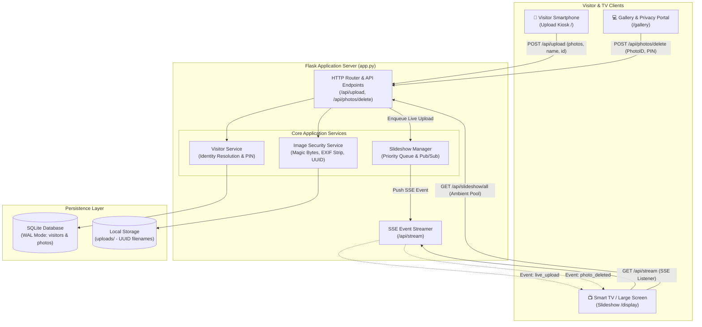
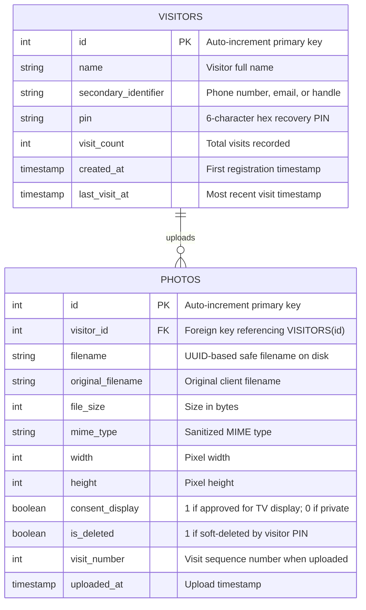
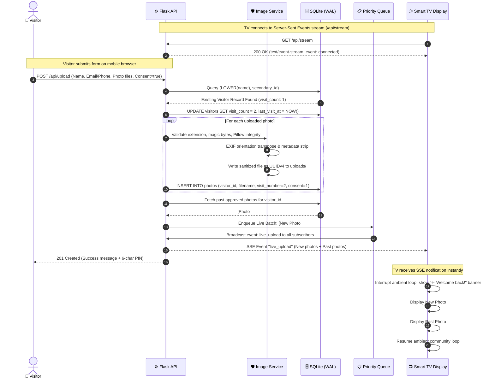

# System Architecture & Technical Design

This document details the architectural design, technology stack choices, database schema, data models, and workflow sequence diagrams for the **Visitor Photo Slideshow** application.

---

## 1. Technology Stack Rationale

| Layer | Technology | Decision Rationale |
| :--- | :--- | :--- |
| **Backend Framework** | **Python (Flask 3.1)** | Minimalist, robust, and zero-compile overhead. Ideal for rapid deployment and grading verification. Python comes pre-installed in almost all development environments, requiring no heavy Node.js runtime or toolchain builds. |
| **Image Processing** | **Pillow (PIL 12.1)** | Industry standard for Python. Enables low-level stream verification (`verify()`), magic byte validation, lossless EXIF transposition (`exif_transpose`), EXIF metadata stripping (protecting GPS privacy), and Lanczos downsampling. |
| **Database** | **SQLite (with WAL Mode)** | Zero-configuration, serverless, self-contained SQL engine. With **Write-Ahead Logging (`PRAGMA journal_mode=WAL;`)**, SQLite supports concurrent multi-threaded writes without database lock contention. |
| **Real-Time Push** | **Server-Sent Events (SSE)** | Unidirectional HTTP streaming supported natively by all modern web and Smart TV browsers (`EventSource`). Unlike WebSockets, SSE requires no custom framing protocol, reconnects automatically with backoff, traverses corporate proxies effortlessly, and uses minimal memory. |
| **Frontend UI** | **Vanilla ES6 + Modern CSS3** | Zero build step or bundling required. Clean CSS custom properties with responsive mobile-first views for visitor uploads and hardware-accelerated 4K layouts for Smart TVs. |

---

## 2. High-Level System Architecture



---

## 3. Data Model & Entity Relationship (ER) Diagram

The persistence layer uses two primary relational entities with foreign-key cascading and composite lookup indexes.



### Table Definitions

#### `visitors` Table
- `id` (INTEGER PRIMARY KEY AUTOINCREMENT)
- `name` (TEXT NOT NULL)
- `secondary_identifier` (TEXT NOT NULL): Normalized lowercase/trimmed identifier (email or phone).
- `pin` (TEXT NOT NULL): 6-character alphanumeric recovery key.
- `visit_count` (INTEGER NOT NULL DEFAULT 1)
- `created_at` (TIMESTAMP DEFAULT CURRENT_TIMESTAMP)
- `last_visit_at` (TIMESTAMP DEFAULT CURRENT_TIMESTAMP)
- **Constraint**: `UNIQUE(name, secondary_identifier)`
- **Index**: `idx_visitors_lookup` on `(name, secondary_identifier)`

#### `photos` Table
- `id` (INTEGER PRIMARY KEY AUTOINCREMENT)
- `visitor_id` (INTEGER NOT NULL REFERENCES visitors(id) ON DELETE CASCADE)
- `filename` (TEXT NOT NULL UNIQUE): UUIDv4 filename (e.g. `e3b0c442...jpg`).
- `original_filename` (TEXT NOT NULL)
- `file_size` (INTEGER NOT NULL)
- `mime_type` (TEXT NOT NULL)
- `width` (INTEGER), `height` (INTEGER)
- `consent_display` (INTEGER NOT NULL DEFAULT 1): Public display authorization flag.
- `is_deleted` (INTEGER NOT NULL DEFAULT 0): Soft deletion flag.
- `visit_number` (INTEGER NOT NULL DEFAULT 1)
- `uploaded_at` (TIMESTAMP DEFAULT CURRENT_TIMESTAMP)
- **Index**: `idx_photos_display` on `(consent_display, is_deleted)`

---

## 4. Workflow Sequence: Upload to Instant TV Playback

This diagram illustrates how an upload from a returning visitor is processed, saved, and prioritized on the smart TV display.



---

## 5. Concurrency & Security Architecture

### 1. Database Concurrency (SQLite WAL Mode)
Traditional SQLite databases lock on write operations. By configuring:
```sql
PRAGMA journal_mode=WAL;
PRAGMA synchronous=NORMAL;
PRAGMA busy_timeout=5000;
```
SQLite operates in **Write-Ahead Logging** mode where readers do not block writers and writers do not block readers. Simultaneous uploads from multiple guests complete concurrently within milliseconds.

### 2. Multi-Layer File Validation
1. **Extension Whitelist**: Rejects non-image files before parsing.
2. **12-Byte Magic Number Inspection**: Verifies byte signatures directly from the binary header to prevent extension spoofing.
3. **Pillow Verification**: Invokes `Image.open().verify()` to detect malformed or polyglot files.
4. **Decompression Bomb Protection**: Caps image dimensions at `MAX_IMAGE_DIMENSION = 4096px`.
5. **Sanitization & EXIF Stripping**: Eliminates embedded GPS location tags and hardware identifiers.
6. **UUID Filename Generation**: Guarantees zero path traversal vulnerabilities (`../../`).

### 3. Smart TV Connection Resilience
- The SSE streaming route yields periodic `: keepalive` heartbeats every 15 seconds to prevent router/proxy disconnections.
- The Smart TV client implements an exponential backoff reconnect algorithm if the local Wi-Fi drops.
- Slideshow playback is non-blocking: while a photo displays, new incoming uploads are queued in memory without UI lag.
